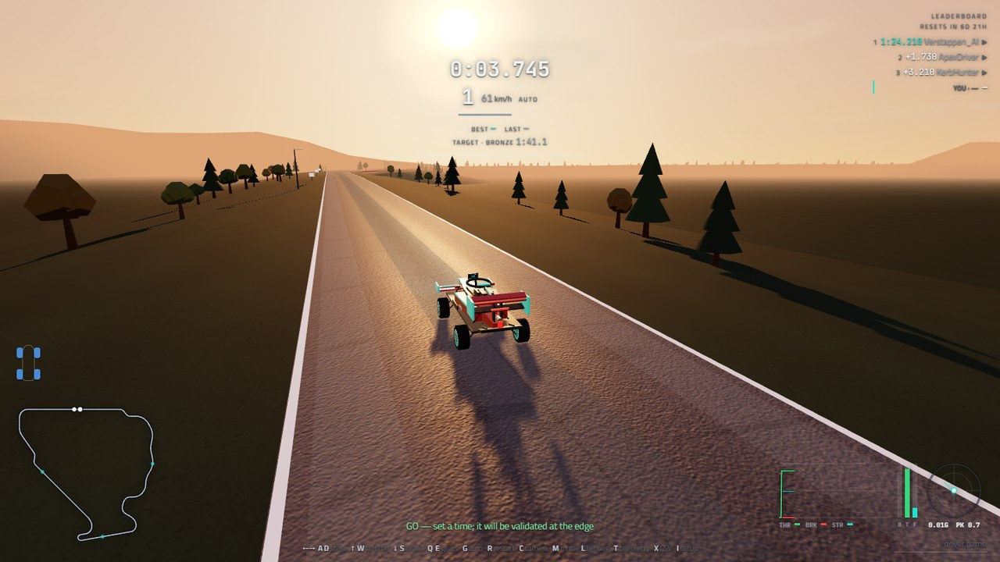
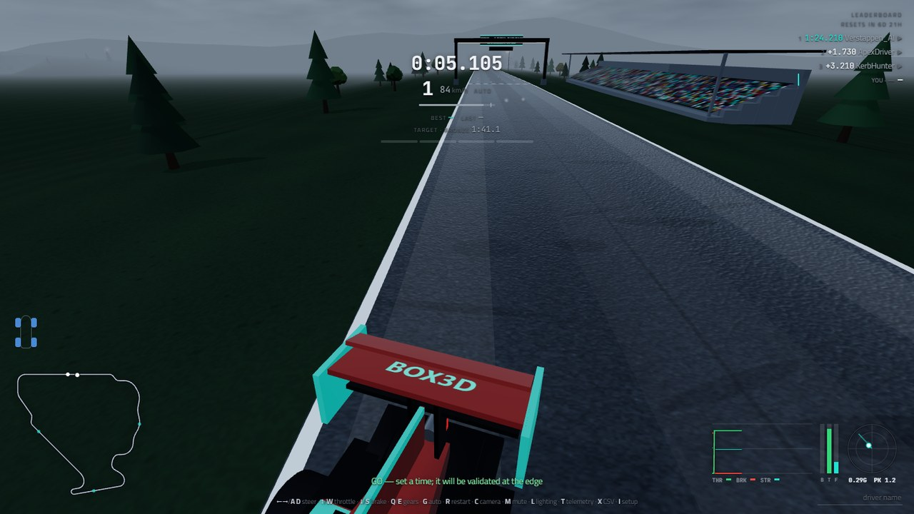
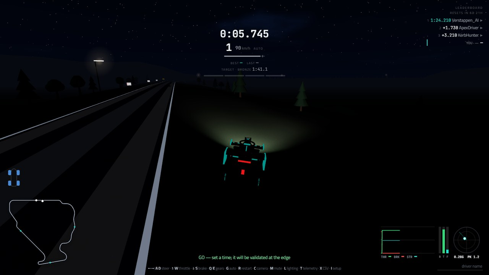

# Serverless Time-Trial Racing

[](https://github.com/eric-rolph/serverless-time-trial-racing-game/actions/workflows/ci.yml)
[](https://sttr-referee.ericrolph.workers.dev)
[](#architecture)
[](#layout)

Edge-authoritative asynchronous sim racing. You race alone against the clock (or any leaderboard ghost) in the browser or native Rust client; a Cloudflare Worker at the edge decides whether your lap was physically real — by re-simulating it through the exact same WebAssembly physics binary.



| Wet Track & Rooster-Tail Spray | Night Circuit & Cobra Floodlights |
|---|---|
|  |  |

## Architecture

**The core trick:** the physics engine (Erin Catto's [Box3D](https://github.com/erincatto/box3d) C17 rigid-body kernel + N=16 brush-model tires + 2-node thermal layer + 6-speed sequential drivetrain) is compiled once to WebAssembly with strict IEEE-754 determinism (`-ffp-contract=off`). Both the browser client and native Rust `wasmtime` client run that exact binary at a strict 400 Hz fixed timestep (1600 Hz wheel/tire substeps); the Cloudflare Worker replays the same bytes in V8 at max speed. Because WebAssembly is bit-exact across hosts, the referee never needs to trust the client — only the signed input log.

```text
wheel/pedals/keyboard
  → Browser (Three.js PBR + Web Audio + WebHID FFB) or Native Rust (wgpu PBR + DirectInput8 FFB)
  → 400 Hz quantized input log (~400 KB, Ed25519-signed)
  → wss://…/api/submit
  → Cloudflare Worker Referee:
      1. Ed25519 signature check
      2. Multi-channel Anti-TAS heuristics (steer slew/jerk/ADC noise, pedal staircases, sync macros)
      3. Deterministic V8 replay through canonical sim.wasm + FNV-1a-64 state hash match
  → Cloudflare KV global leaderboard + downloadable ghost replays
```

Every Monday at 00:00 UTC, a GitHub Actions workflow generates a fresh seeded v2 clothoid procedural circuit (with C1 cosine terrain aprons, collision props, and automated apron/prop clearance verification), validates raceability with the headless autopilot, compiles the canonical kernel, and redeploys the Worker worldwide.

## Highlights

- **Deterministic Vehicle Dynamics (`physics/`):** 400 Hz chassis + 1600 Hz quarter-car unsprung suspension, N=16 discretized brush contact patch with emergent pneumatic trail & combined-slip friction circle, 2-node tire thermal model with track conduction, kinematic camber/toe, anti-roll bars, slip relaxation length ODE, 6-speed sequential gearbox with viscous LSD & downshift rev-match shock, speed-squared aero downforce, analytic C1 road surface, and deterministic soft-body crash damage.
- **Browser PBR Engine & VFX (`worker/public/`):** Zero-CDN Three.js client with procedural `PMREMGenerator` sky/sun IBL reflections, Rayleigh/Mie atmospheric sky + drifting procedural clouds + night starfield, normal/roughness-mapped PBR tarmac with dynamic wet-weather specular reflections, sculpted clearcoat open-wheeler with articulated double-wishbone suspension, animated cockpit butterfly steering wheel + live RPM shift-LEDs, glowing carbon brake discs, ring-buffered dynamic tire skidmarks, tire smoke / gravel / wet rooster-tail spray / crash sparks, and 5-light FIA countdown gantry.
- **Procedural Motorsport Audio (`worker/public/js/audio.js`):** Zero-asset Web Audio DSP featuring a 5-oscillator firing-order harmonic engine bank, asymmetric `tanh` WaveShaper load saturation, exhaust/intake formant filters, straight-cut sequential gearbox whine, off-throttle overrun exhaust pops, $v^2$ wind rush, stereo-panned front/rear tire scrub + over-limit squeal, kerb suspension thumps, and off-track gravel rumble.
- **APEX Unboxed HUD & Pro Telemetry:** Timing-tower delta numeral + centered graphical delta bar, sector splits + theoretical optimal lap (`OPT`), ghost minimap, toggleable (`T`) Garage 61-style rolling pedal/steer sparkline + FFB clipping meter + live 2D G-force friction circle, and 1-click MoTeC-ready CSV telemetry export (`X`).
- **Native Rust `wgpu` Client & DirectInput8 FFB (`client/`):** Cook-Torrance GGX PBR shader + full-screen physical atmospheric sky pass + ACES Filmic tone mapping, sculpted 3-material open-wheeler, multi-camera (`C`: chase / cockpit / bumper), speed-reactive FOV, native ultrawide (`21:9` / `32:9`), and DirectInput8 constant-force FFB with standstill attenuation and soft-knee non-clipping limiting.
- **Seeded v2 Clothoid Circuit Composer (`trackgen/`):** Deterministic archetype-based clothoid composer (`--circuit seeded --seed <N>`) with exact 360° heading closure, POCS loop closure, CW/CCW mirroring, C1 elevation anchors + corkscrew drops, fold-capped C1 cosine terrain aprons, tire/Armco collision props, and zero-tolerance mesh/prop verification (`check_apron.py`).

## Layout

| dir | what |
|-----|------|
| `physics/` | C17 deterministic kernel: Box3D + N=16 brush tires + 2-node thermal + 1600 Hz quarter-car suspension + 6-speed drivetrain + softbody damage |
| `client/` | Rust: `wasmtime` host, 400 Hz accumulator loop, Cook-Torrance PBR `wgpu` renderer, 1 kHz input polling, DirectInput8 FFB, Ed25519 signing |
| `worker/` | Cloudflare Worker referee (Ed25519 → multi-channel Anti-TAS → V8 `sim.wasm` replay → KV leaderboard) + self-contained Three.js PBR web client |
| `trackgen/` | Python: seeded v2 clothoid circuit composer, C1 terrain aprons, collision props, `check_apron.py` verifier, TRK1 v2 packer |
| `docs/` | ARCHITECTURE, CONTRACTS (binding ABI & binary formats), APEX design spec, TIRE-MODEL, DRIVETRAIN, TERRAIN, FFB, SOFTBODY |

## Live deployment

- **Play in the browser: <https://sttr-referee.ericrolph.workers.dev>** — same `sim.wasm` physics, same referee, multi-device wheel/pedal calibration (`I`), and experimental WebHID Fanatec FFB.
- **Controls:** `W/S` or `↑/↓` throttle/brake · `A/D` or `←/→` steer · `Q/E` shift · `G` auto/manual · `C` camera (`chase · cockpit · bumper · TV`) · `L` lighting (`auto · golden · midday · overcast · wet · night`) · `T` telemetry overlay · `X` export lap CSV · `M` mute · `R` restart · `I` wheel & FFB setup.
- **Referee API:** `/api/leaderboard`, `/api/track/current`, `/api/sim/current`, `/api/replay?track&player`, `/api/submit` (WebSocket).
- Always race native runs with the **canonical** binaries the referee validates against (`curl -O https://sttr-referee.ericrolph.workers.dev/api/sim/current`) — a self-built `sim.wasm` from a different compiler version will replay-mismatch.

## Quick start

```sh
# 1. Generate and verify a seeded v2 clothoid circuit
cd trackgen && pip install -r requirements.txt
python generate_track.py --circuit seeded --seed 902630 --out-dir ../assets/tracks/dev
python check_apron.py ../assets/tracks/dev/track.json
python pack_track.py ../assets/tracks/dev/track.json

# 2. Build the physics kernel to wasm (needs emsdk on PATH)
bash physics/build_wasm.sh && node physics/tests/wasm_smoke.mjs

# 3. Race natively (Rust + wgpu + wasmtime)
cd client
cargo run --release -- race --track ../assets/tracks/dev/track.bin \
  --sim-wasm ../physics/out/sim.wasm

# 4. Submit a recorded lap.laplog
cargo run --release -- submit lap.laplog --to wss://sttr-referee.<your>.workers.dev/api/submit
```

Worker checks & deployment:

```sh
cd worker && npm ci
npm run check && npm test
npx wrangler deploy   # needs CLOUDFLARE_API_TOKEN; assets/ staged by CI
```

## Honest threat model

- **Impossible:** speed hacks, teleports, checkpoint clipping, modified physics — an accepted lap *is* a physics-valid input sequence re-simulated deterministically at the edge.
- **Arms race:** tool-assisted input crafting through the real physics. Stage 2 multi-channel heuristics (`flat_runs`, `spline_smooth`, `value_grid`, `no_sensor_noise`, `inhuman_slew`, `pedal_staircase`, `sync_macro`) flag or reject scripted profiles while keeping honest analog wheels and binary keyboard pedals playable. See [docs/DECISIONS.md](docs/DECISIONS.md) (ADR-006).

## Notes

- Edge replay validation takes seconds of CPU per submission and targets Cloudflare Workers Paid (30 s CPU budget), with a built-in free-tier queue sweeper (`VALIDATE_MODE=queue`).
- Binding binary layouts (`TRK1` v1/v2, `LAPLOG`, `SimStateV1`, WASM ABI) live in [docs/CONTRACTS.md](docs/CONTRACTS.md).
